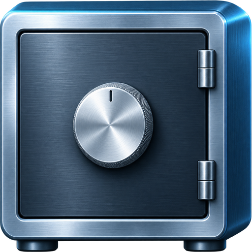

# Voltura Vault

A self-hosted password manager for logins, secure notes, SSH keys and files. The app encrypts items and attachments on your device before syncing them to a server you operate.

[Product website](https://voltura-vault.voltura.se/) · [Architecture](docs/ARCHITECTURE.md) · [Setup and builds](docs/SETUP.md) · [Security](SECURITY.md)

## What it does

- Organize logins, cards, identities, notes and SSH keys with folders, search and custom fields.
- Generate passwords, passphrases and usernames, and preview Bitwarden JSON before importing.
- Attach files up to 100 MB and choose which encrypted files to keep available offline.
- Use the responsive web app in a browser or build the Windows desktop client. Linux and macOS desktop configurations are previews.

## Start here

This is an early source release for self-hosters. It ships with reserved example hostnames, so it cannot connect to a real vault out of the box. The [setup guide](docs/SETUP.md) shows where to configure your own hosts and how to run a local preview. Try it with sample data and verify that you can restore your own backup before relying on it.

## Support development

Voltura Vault is built by [Voltura AB](https://voltura.se/). Support development through [Ko-fi](https://ko-fi.com/G2G74W5F8) or [PayPal](https://www.paypal.com/donate?hosted_button_id=7PN65YXN64DBG).

## License

Voltura Vault source code is [MIT licensed](LICENSE), © 2026 Voltura AB. Dependencies and wordlists retain their own licenses; see the [wordlist sources and attribution](src/dictionaries/SOURCES.md).
